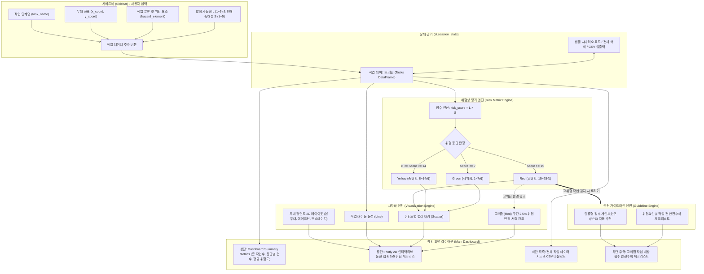

# Design Specification Document (design.md)
## 프로젝트명: StageGuard (무대 설비 작업 위험성 평가 및 동선 시뮬레이터)

### 1. 시스템 아키텍처 및 데이터 플로우 노드 맵 (Architecture & Data Flow)

### 2. 시스템 아키텍처 상세 (System Architecture)
- **Architecture Type:** Streamlit 기반 단일 파일/모듈형 로컬 웹 애플리케이션
- **Data Flow:** 
  1. 사용자 입력 (작업명, 위치 X/Y, 위험 요소, 가능성 L, 중대성 S)
  2. 위험성 평가 엔진 (Score = L × S 계산 및 Risk Grade 판정)
  3. 시각화 엔진 (Plotly 기반 2D 무대 평면도 맵 렌더링)
  4. 가이드라인 엔진 (고위험 요소 감지 시 안전 수칙 및 필수 PPE 팝업/출력)

### 3. 화면 레이아웃 구조 (UI Layout)
- **사이드바 (Sidebar):**
  - [입력 폼] 작업 단계 이름, 무대 내 X/Y 좌표, 작업 유형 선택
  - [위험성 평가] 발생 가능성 (1~5), 피해 중대성 (1~5) 슬라이더/드롭다운
  - [버튼] "작업 데이터 추가" 버튼
- **메인 영역 (Main Content Area):**
  - **상단 (Dashboard Summary):** 총 등록 작업 수, 고위험(Red) 작업 수, 위험도 지수 요약 카포(Metric)
  - **중단 (Visual Map):** Plotly 2D Scatter Plot (무대 레이아웃 상의 작업 위치 및 위험도별 색상 마커)
  - **하단 (Table & Guide):** 전체 작업 위험성 평가 데이터프레임(Table) 및 고위험 작업 대상 필수 안전 수칙 체크리스트

### 4. 데이터 구조 (Data Schema)
- **DataFrame Structure:**
  - `task_name` (str): 작업명 (예: 트러스 조립, 조명 타워 설치)
  - `x_coord` (float): 무대 X 좌표
  - `y_coord` (float): 무대 Y 좌표
  - `likelihood` (int): 발생 가능성 (1~5)
  - `severity` (int): 중대성 (1~5)
  - `risk_score` (int): 가능성 × 중대성
  - `risk_grade` (str): Red (>=15), Yellow (8~14), Green (<=7)
